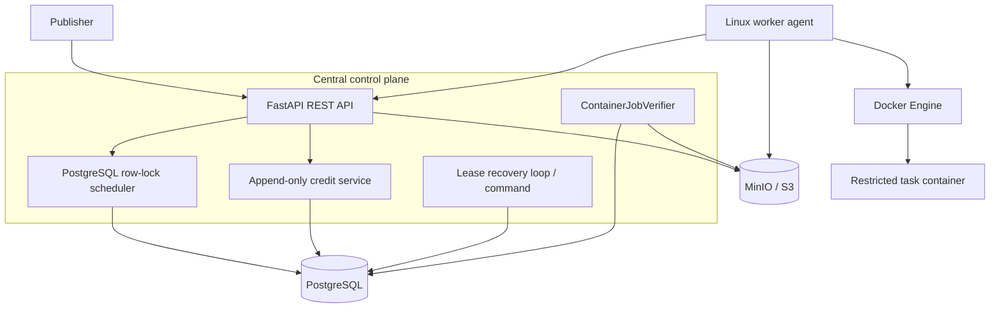

# MVP architecture

## Repository assessment

The repository was empty at implementation start: there was no README, manifest, source,
database model, migration, test, or deployment convention to preserve. The fallback stack
specified by the product brief was therefore selected.

## Components

- `src/cpb`: synchronous FastAPI and SQLAlchemy 2 control plane. A request owns one database
  transaction; domain errors roll it back.
- `src/cpb_worker`: standalone Linux polling agent. It detects host capacity, validates ZIP
  extraction, invokes Docker with an argument vector, heartbeats, uploads logs/artifacts, and
  records an active lease locally for restart recovery.
- PostgreSQL: durable queue, row locks, task/run state, credentials, artifact metadata, and
  immutable ledger. Leasing orders queued tasks and uses `FOR UPDATE SKIP LOCKED`.
- MinIO: source bundles, log snapshots, result objects, and artifacts. The API computes hashes
  while receiving uploads and stores the server-observed digest in S3 metadata.
- Background recovery: each API process may scan for expired leases; row locks make processing
  safe and idempotent. A one-shot CLI command supports operations and tests.

## Assumptions

- Only `ContainerJob`, Linux, CPU execution, public/non-sensitive ZIP bundles, and allow-listed
  images are supported.
- A node executes at most one job at a time in this MVP. Its status is `busy` while leased.
- Task compatibility requires Linux, sufficient advertised capacity, and an image included in
  both the global allow list and the node's supported list. Common amd64/arm64 labels are
  accepted; per-task architecture selection is deferred.
- API keys are development-oriented bearer secrets; worker and lease credentials are separate.
  Only HMAC-SHA256 hashes are persisted.
- The source of truth for balances is `SUM(credit_transactions.amount)`. There is no mutable
  balance column.
- Verification is synchronous because the MVP's checks are bounded metadata/object operations.
  `TaskVerifier` keeps trusted validator execution extensible.
- The initial Alembic revision creates the SQLAlchemy metadata as a single baseline. Later
  schema changes must use explicit incremental revisions.

## Transaction boundaries

Submission locks the task and publisher account, appends the reservation, and queues the task
in one commit. Leasing locks the node and one queued task, creates a run, and consumes advertised
capacity in one commit. Completion locks run/task/node, verifies objects, persists artifact
metadata, appends reward/fee entries, and marks completion in one commit. Unique idempotency keys
and the unique `(task_run_id, name)` artifact constraint protect request retries.

