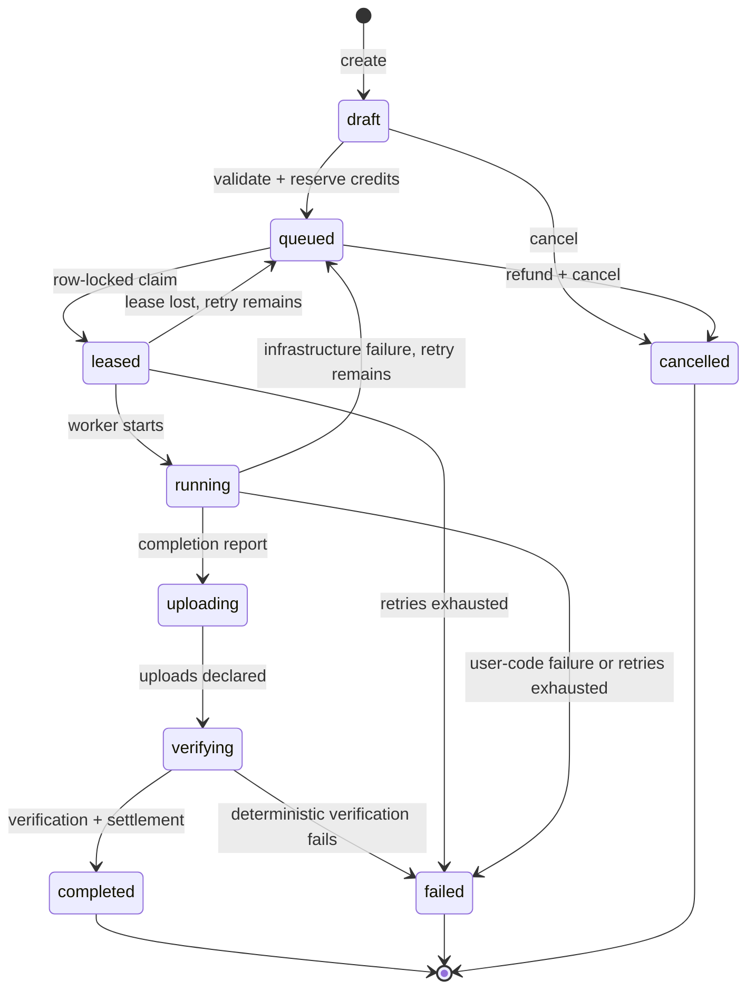

# Task lifecycle

Run states are `leased → running → uploading → verifying → succeeded`. Active runs may instead
become `failed` or `lost`. Every mutation calls the centralized transition helpers; invalid
edges return HTTP 409 and leave the transaction unchanged.

## Leasing and recovery

`POST /worker/lease` locks the authenticated node, selects one compatible queued task in FIFO
order with `FOR UPDATE SKIP LOCKED`, and returns a random lease token exactly once. Only its HMAC
hash is stored. Start, heartbeat, upload, complete, and fail requests require both the node token
and lease token.

Run heartbeats extend the expiry. Recovery locks expired active runs, marks them lost, reduces
node reputation, releases advertised capacity, and increments the task retry count. It requeues
while `retry_count <= max_retries`; otherwise it fails the task and refunds the reservation.
Terminal runs are outside the recovery query, making repeat recovery harmless.

## Completion

The verifier checks node/run ownership through authentication before it runs. It then checks the
expected exit code, declared and required artifact names, per-run object prefixes, server-observed
hashes and sizes, and the artifact size ceiling. A valid result is settled and completed in the
same database transaction. A duplicate successful completion returns the terminal run without
adding artifacts or ledger entries again.

